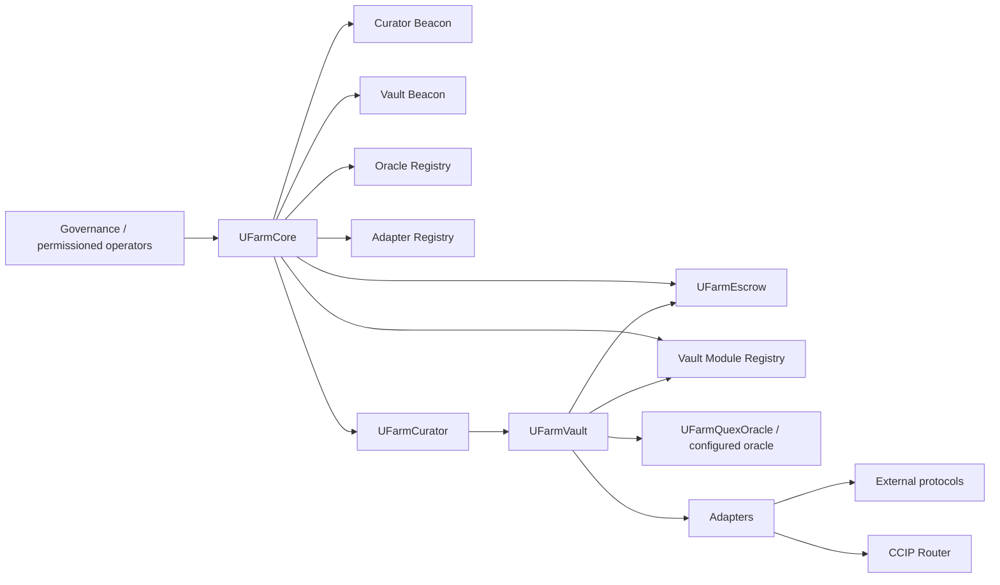
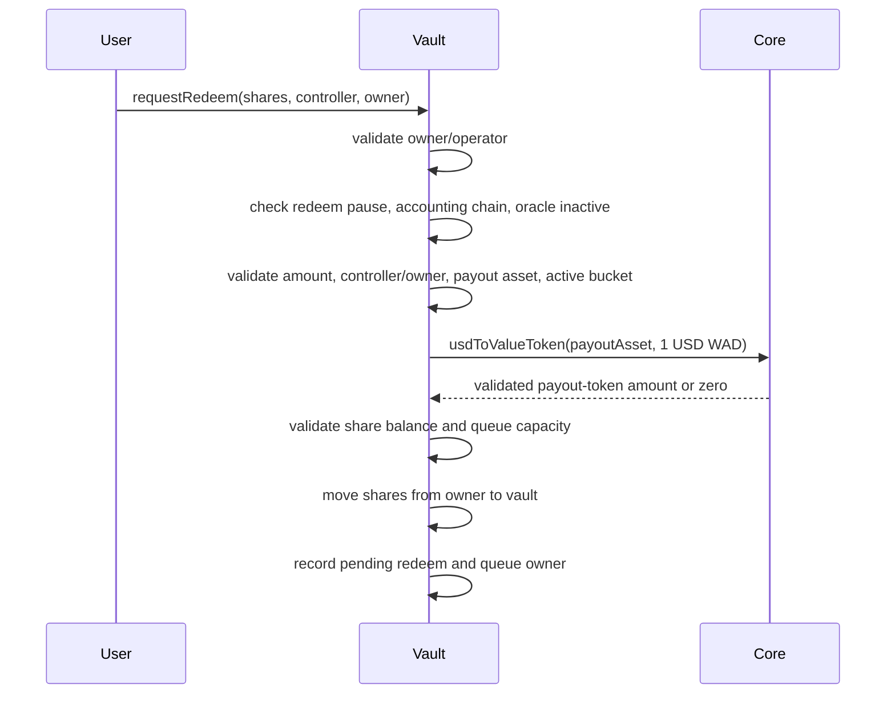
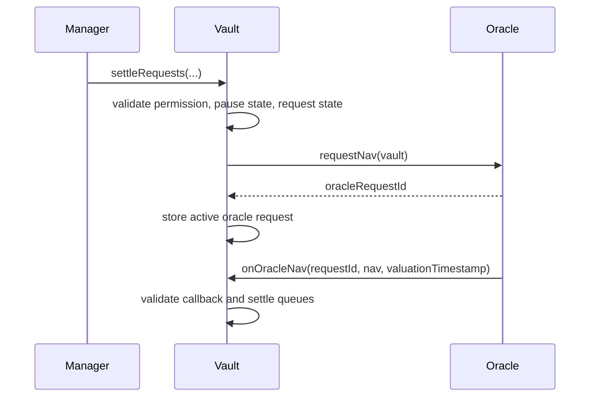
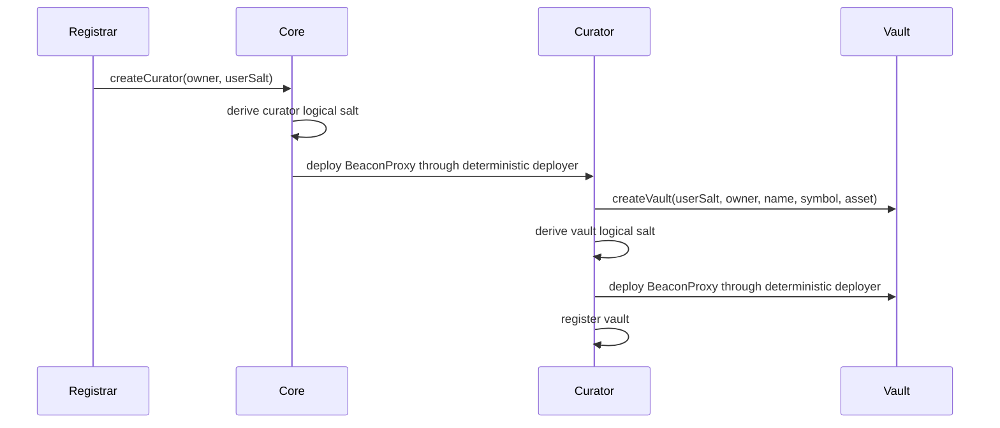

# UFarm EVM Architecture

UFarm is an EVM asset-management protocol for creating and operating managed vaults. The protocol separates governance, vault ownership, asset custody, accounting, oracle settlement, strategy execution, and cross-chain movement into explicit contract boundaries.

This document describes the public architecture of the smart-contract system. It is intended for protocol integrators, auditors, deployers, and technical partners who need a high-level model of how the contracts work together.

## System Overview

UFarm is built around six contract families:

- `UFarmCore`: protocol root, registry, permission root, pause controller, and shared configuration source.
- `UFarmCurator`: curator-level vault factory and curator permission scope.
- `UFarmVault`: user-facing vault share token and facade for vault operations.
- Vault modules: delegatecall modules registered in Core for request lifecycle, administration, and adapter gateway behavior.
- `UFarmEscrow`: protocol-wide custody ledger for pending and claimable user assets.
- Oracle and adapter contracts: NAV oracle integration, strategy adapters, arbitrary external protocol calls, and cross-chain transfer logic.

At a high level:



The main principle is separation of authority and state:

- Core stores protocol truth and shared configuration.
- Curators create and administer their own vaults inside the protocol rules.
- Vaults own share accounting, user request state, oracle lifecycle, and strategy execution entrypoints.
- Escrow holds user assets but does not decide prices, permissions, or settlement.
- Oracles report NAV; vaults settle requests from validated oracle data.
- Adapters execute strategy or transport logic through the vault, subject to Core routing and vault permissions.

## Core Concepts

### Core Registry

`UFarmCore` is the protocol root contract. It stores:

- protocol permissions;
- global and curator-level pause masks;
- value-token Chainlink feed configuration, cached token/feed units, freshness limits, and USD price bounds;
- vault oracle registry with wildcard fallback;
- vault adapter registry with wildcard fallback;
- vault module registry;
- protocol fee and settlement timing parameters;
- deterministic deployment dependencies;
- curator and vault beacon addresses;
- cross-chain router, token, fee token, gas limit, accounting chain, and CCIP selectors.

The accounting core assumes Chainlink feed freshness is sufficient on the accounting chain. L2 accounting-chain deployments require sequencer uptime handling before price feeds are consumed for settlement. CCIP selector configuration does not validate target-chain EVM capability; operators must only configure satellite chains that can execute the repository's compiled bytecode, including Shanghai/Cancun opcodes such as `PUSH0`.

Core does not hold vault accounting state. It tells other contracts what is configured and who is authorized.

### Curators

A curator is a protocol-level asset-management unit. A curator contract:

- has its own permission mask;
- creates vaults through the Core-configured vault beacon;
- records which vaults belong to it;
- can perform curator finance operations for its vaults when authorized.

Curators are created by Core using deterministic deployment. Vaults are then created by curators using deterministic deployment, so curator and vault addresses can be derived from salts and factory context.

### Vaults

`UFarmVault` is the main user-facing contract. A vault:

- is an ERC-20-compatible share token;
- stores vault identity, curator, Core, default asset, metadata, and share balances;
- exposes ERC-7540-style asynchronous deposit and redeem flows;
- supports direct and signature-based operator approvals;
- stores vault-local permissions;
- tracks an irreversible `Active` or `Terminated` lifecycle status;
- routes lifecycle, admin, and adapter operations to Core-registered vault modules;
- receives oracle NAV callbacks through the lifecycle module;
- receives CCIP messages through the adapter gateway module.

The vault itself is the share token. There is no separate share-token contract.

### Vault Modules

Vault behavior is split into modules to keep the base vault smaller and to isolate major responsibilities.

Core currently registers modules for:

- `VaultLifecycleModule`: deposit requests, redeem requests, signed request batches, oracle settlement, cancellation, claims, fee accrual, timeout reset, and manual oracle resend.
- `VaultAdminConfigModule`: vault fee configuration, investment range, client tier configuration, and irreversible vault termination.
- `VaultAdapterGatewayModule`: adapter execution, CCIP receive routing, ERC-1271-style digest authorization, and signed-message revocation.

CCIP receive execution is revert-propagating. If a pause or oracle-active state prevents delivery until the CCIP execution window expires, operators may need to use Chainlink CCIP OffRamp `manuallyExecute` as part of recovery.

Modules are called through the vault and run by `delegatecall`, so they operate on vault storage. Direct calls to module contracts are rejected.

### Escrow

`UFarmEscrow` is a protocol-wide custody ledger. It stores balances by:

```text
vault -> asset -> beneficiary
```

Escrow is intentionally passive. It does not know NAV, share price, fees, adapters, oracle state, or curator policy. Escrow and value-token accounting assume standard non-rebasing ERC-20 tokens. Rebasing, elastic-supply, fee-on-transfer, and other balance-changing tokens are unsupported because the escrow ledger stores nominal amounts. A registered vault tells escrow when to:

- credit assets from a user;
- release assets to a user;
- release assets back to the vault;
- unlock a beneficiary balance for withdrawal.

This keeps custody isolated from pricing and business logic.

### Value Tokens

Core stores one Chainlink pricing configuration per value token, including the feed address, cached token/feed units, freshness limit, and accepted USD price bounds. The presence of that configuration plus a valid current feed answer is the token registry boundary; there is no independent boolean allowlist.

Quex NAV is expressed as USD WAD. Core validates Chainlink answers, enforces freshness and bounds, and owns decimal normalization for token-to-USD and USD-to-token conversion.

`valueTokenToUsd` and `usdToValueToken` are non-reverting views. If pricing is unavailable or invalid, they return zero instead of reverting.

Vaults do not read Chainlink feeds directly and do not normalize token decimals on their own. They rely on Core conversion views at request validation and settlement edges.

Escrow remains price-agnostic. It only moves or holds balances as instructed by a registered vault.

The intended production deployment assumes Ethereum mainnet as the accounting chain, but the contracts do not enforce that choice: `accountingChainId` remains configurable for testing and other deployments. No L2 sequencer feed is included for the intended mainnet accounting setup.

The cross-chain asset is configured separately in Core as the `crossChainToken`.

### Permissions

UFarm uses bitmask permissions rather than role arrays.

There are three permission scopes:

- Core permissions, such as curator registrar, config manager, oracle manager, adapter manager, pause manager, finance manager, module manager, and price guard manager.
- Curator permissions, such as vault creator and curator finance manager.
- Vault permissions, such as asset manager, settle manager, config manager, and customer manager.

Each scope also has high-level `OWNER`, `ADMIN`, and `MEMBER` bits. Permission checks use combinations of these bits depending on the operation.

### Pause Masks

Core stores a global pause mask and per-curator pause masks. The system can pause broad or narrow flows, including:

- full protocol operation;
- deposit requests;
- redeem requests;
- claims;
- cancellations;
- oracle requests;
- oracle callbacks;
- adapter execution;
- cross-chain operations;
- share transfers;
- escrow operations.

Pause checks are enforced by the vault, modules, adapters, and escrow where relevant.

## Component Architecture

### `UFarmCore`

Core is an upgradeable UUPS contract. Its main responsibilities are:

- hold protocol-level permissions;
- initialize factory dependencies;
- initialize cross-chain accounting configuration;
- create deterministic curators;
- resolve vault oracles and adapters;
- store vault module addresses;
- store global and curator pause masks;
- store protocol-level fee and timing parameters;
- expose the escrow, deterministic deployer, curator beacon, and vault beacon;
- allow Core-owned finance actions such as setting vault operators and claiming Core-owned vault redeems.

Core uses wildcard fallbacks for oracle and adapter resolution:

- `oracleForVault(vault)` returns a vault-specific oracle, or the wildcard oracle configured at `address(0)`.
- `adapterForVault(adapterId, vault)` returns a vault-specific adapter, or the wildcard adapter configured for `(adapterId, address(0))`.

This allows protocol-wide defaults while still supporting per-vault overrides.

### `UFarmCurator`

Curator contracts are initialized with:

- Core address;
- curator owner;
- curator salt.

A curator can create vaults when the caller has `MEMBER | CURATOR_VAULT_CREATOR`. Vault creation validates:

- vault owner;
- metadata;
- default asset;
- curator registration in Core;
- Core vault beacon configuration.

The curator records vault membership after deployment. Escrow later uses this membership check to ensure that only registered vaults can mutate custody balances.

### `UFarmVault`

The vault facade exposes:

- identity and metadata views;
- vault lifecycle status and owner-controlled termination;
- ERC-20 share views and transfer methods;
- operator approval methods;
- vault-local permission methods;
- admin configuration methods routed to the admin module;
- request lifecycle methods routed to the lifecycle module;
- oracle lifecycle methods routed to the lifecycle module;
- adapter and signature methods routed to the adapter gateway module;
- CCIP receive routing through the adapter gateway module.

Vault storage is namespaced by libraries so modules can safely share the same proxy storage context. Vault status is stored with the vault configuration and is read by the admin and lifecycle modules.

### `UFarmEscrow`

Escrow is an upgradeable UUPS contract tied to one Core. It accepts custody mutation calls only from registered vaults. A caller is considered registered when:

- the caller is a contract;
- the caller reports a curator;
- Core recognizes that curator;
- the curator recognizes the caller as one of its vaults.

Escrow rejects paused custody operations when Core has either full protocol pause or escrow operations pause enabled.

### `UFarmQuexOracle`

The Quex oracle adapter implements the UFarm oracle interface. It:

- creates or reuses Quex flows per vault;
- stores request id to vault routing;
- validates Quex callbacks;
- decodes NAV values;
- forwards validated NAV and valuation timestamp to the vault oracle callback.

The vault remains responsible for active request tracking, timeout handling, reset behavior, and settlement after receiving NAV.

### Adapters

Adapters are executed by vaults through the adapter gateway module. Core decides which adapter is configured for a vault and adapter id.

The adapter model supports:

- strategy execution against external protocols;
- arbitrary but whitelisted external calls;
- EIP-712 digest authorization for ERC-1271 signing workflows;
- cross-chain CCIP transfer state.

Adapters are expected to be stateless or to use explicit namespaced storage because they run in the vault storage context by `delegatecall`.

## Money Flows

### Deposit Request

A public deposit request moves assets from the user into escrow and records a pending deposit in the vault.

```mermaid
sequenceDiagram
    participant User
    participant Vault
    participant Escrow
    participant Core

    User->>Vault: requestDeposit(assets, controller, owner)
    Vault->>Vault: require Active status
    Vault->>Vault: validate client verification when applicable
    Vault->>Vault: validate owner/operator
    Vault->>Vault: check deposit range
    Vault->>Vault: check deposit pause, accounting chain, oracle inactive
    Vault->>Vault: validate amount, controller/owner, asset, active bucket
    Vault->>Core: valueTokenToUsd(asset, assets)
    Core-->>Vault: validated USD WAD or zero
    Vault->>Vault: validate queue capacity; record pending deposit and queue owner
    Vault->>Escrow: creditFrom(asset, owner, owner, assets, lockedTill)
    Escrow->>User: transferFrom(owner, escrow, assets)
```

Important properties:

- new deposits are accepted only while the vault status is `Active`;
- the caller must be the owner or an approved operator;
- each owner has a single active request bucket;
- deposit assets are held in escrow before settlement;
- pending deposit assets are excluded from vault NAV until settlement;
- public deposits respect investment range configuration;
- custom deposits can require signed client tier verification.

### Redeem Request

A redeem request moves vault shares into the vault and records a pending redeem.



The shares are locked inside the vault until the request is cancelled, reset, failed during settlement, or settled successfully.

### Signed Request Batches

Settlement managers can submit signed batches of deposit and redeem requests. This lets an authorized party collect user intent off-chain and submit it in one on-chain transaction before oracle settlement starts.

Signed deposit requests are rejected when the vault is terminated. Signed redeem requests remain available, subject to the normal permission, signature, pause, accounting-chain, and oracle-state checks.

Signed request validation includes:

- EIP-712 typed data;
- owner request nonce;
- deadline;
- request owner;
- signature validity.

The signature path supports both externally owned accounts and contract owners that implement ERC-1271.

Invalid signed requests are skipped rather than forcing the entire batch to revert. This keeps batch settlement robust when one request is stale or invalid.

### Oracle Settlement

Settlement starts when a vault settle manager calls `settleRequests`, either with existing queued requests or with signed request batches.



The NAV callback is the pricing point. The lifecycle module uses NAV, current supply, pending queues, and fee state to:

- accrue protocol and curator fees;
- settle deposits into shares;
- settle redeems into assets;
- remove failed buckets from queues;
- unlock or release custody as needed;
- update price guard and fee accounting state.

If the vault is terminated, settlement does not convert pending deposits into shares. Pending deposits remain in escrow so their owners can cancel them. Redeem settlement continues normally.

### Deposit Settlement

During settlement, each pending deposit is converted from token amount to validated USD WAD through Core, then from USD WAD into shares against the settlement NAV and the pricing supply.

Successful deposit settlement:

- releases escrowed deposit assets from escrow to the vault;
- mints shares to a claimable deposit bucket;
- lets the owner claim shares through the deposit entrypoint.

Failed deposit settlement:

- removes the owner from the pending queue;
- returns or leaves assets according to the failure path;
- emits a request failure event.

An invalid price affects only requests that use that asset. Other requests in the bounded settlement queue continue normally.

Termination is not treated as a failed deposit settlement. Deposits that were still pending when termination occurred remain pending and cancellable rather than being consumed by a later NAV callback.

### Redeem Settlement

During settlement, each pending redeem is converted from shares into USD WAD through the settlement NAV, then from USD WAD into the payout token amount through Core.

Successful redeem settlement:

- burns or consumes locked shares;
- credits payout assets to escrow for the owner;
- lets the owner claim or withdraw assets according to the claim path.

Failed redeem settlement:

- removes the owner from the pending queue;
- returns locked shares to the owner;
- emits a request failure event.

An invalid price affects only requests that use that payout asset. Other requests in the bounded settlement queue continue normally.

### Claims And Escrow Withdrawals

Claims are separate from settlement.

Deposit claim:

- mints or delivers the settled vault shares to the claim owner.

Redeem claim:

- releases settled assets from escrow to the receiver, or leaves them withdrawable depending on the claim path.

Escrow also supports direct beneficiary withdrawal for unlocked balances. Locked balances cannot be withdrawn until the lock expires or the vault unlocks them.

### Fees

Fees are share-based. They are accrued during NAV settlement before user request settlement.

The fee model includes:

- global protocol AUM fee configured in Core;
- vault management fee configured by vault permissions;
- packed performance fee schedule configured by vault permissions;
- high-water mark for performance fees;
- protocol share of curator fee shares;
- curator share of curator fee shares.

Fee shares are minted to protocol contracts:

- Core receives protocol fee shares.
- Core receives the protocol split of curator fee shares.
- Curator receives the curator split of curator fee shares.

Those fee shares are normal vault shares. Core and Curator can later redeem them through the same asynchronous redeem lifecycle.

Performance fees are charged only above the high-water mark. The current implementation supports a packed multi-step performance fee schedule with capped fee rates.

## Vault Lifecycle Workflows

### Vault Creation



Curator and vault deployment use logical salts and CreateX-compatible deterministic deployment. The system distinguishes logical protocol salts from CreateX salts so deterministic deployment can remain sender-bound and chain-policy-aware.

### Operator Approvals

Vault users can approve operators directly or by EIP-712 signature.

Operators can act for the owner in supported request flows, but operator approval does not bypass settlement rules, pause checks, or custody rules.

### Admin Configuration

Vault config managers can set:

- management fee;
- performance fee schedule;
- investment range;
- client tier requirement.

Vault fees are locked after shares exist. This prevents fee changes after investors have entered a vault.

### Vault Termination

Each vault has an irreversible lifecycle status:

- `Active`: the initial status. New direct, custom-asset, and signed deposit requests are allowed.
- `Terminated`: no new deposit requests are accepted and pending deposits are not settled into shares.

Only a vault owner can call `terminate()`. The vault facade routes the call to `VaultAdminConfigModule`, which checks owner permission, updates the status stored in vault configuration, and emits `VaultTerminated`.

Termination cannot be reversed. It stops new capital inflows without blocking existing users from exiting:

- settled deposit claims remain available;
- pending deposits remain cancellable and can be returned from escrow;
- new redeem requests remain available;
- pending redeem cancellation remains available;
- redeem settlement and claims remain available.

These operations are still subject to their normal pause, accounting-chain, oracle-state, custody, and authorization checks. "Available after termination" does not bypass those independent safety controls.

### Oracle Timeout And Recovery

A vault stores one active oracle request at a time. If the oracle does not call back within the configured timeout, authorized users can reset or resend the request.

Reset behavior unwinds pending request state rather than pricing requests without NAV. Manual resend creates a new oracle request while preserving the intended settlement flow.

### Price Guard

Core stores an allowed price fluctuation parameter. Vault settlement can raise an invalid-price state if a new NAV implies a token price movement outside the configured threshold.

When invalid price is raised, finance paths are locked until an account with Core price guard authority resets the invalid-price state.

## Cross-Chain Architecture

UFarm cross-chain support is vault-level asset movement coordinated by Core configuration and implemented through `CrossChainAdapter`.

The model separates chains into:

- Accounting chain: the chain where user request lifecycle, share issuance, oracle settlement, fee accrual, and claims run.
- Satellite chains: chains where same vault deployments can hold or move strategy assets but cannot run user financing flows.

### Cross-Chain Goals

The cross-chain subsystem is designed to:

- move the configured cross-chain token between vault deployments;
- keep share accounting and user request settlement on the accounting chain;
- support one active cross-chain session per vault;
- preserve an outbox for failed dispatch recovery;
- validate inbound CCIP messages before changing vault state;
- lock or unlock oracle settlement depending on the cross-chain session state.

### Cross-Chain Configuration

Cross-chain transfers depend on Core-level and vault-level configuration:

- `accountingChainId` defines the only chain where user financing flows and settlement can run.
- `crossChainToken` defines the only asset that may be moved through the cross-chain adapter.
- chain selectors map internal chain ids to CCIP chain selectors.
- router, fee token, and per-target gas limits define the transport path.
- the same vault address is expected on both sides of the message because the receiver and sender are encoded as the local vault adapter address.

The adapter does not treat cross-chain messaging as a generic arbitrary-message bridge. It handles a narrow transfer protocol with explicit message types, a local monotonic nonce, an active session nonce, expected source chains, and token delivery rules.

### Message Types And Session State

Cross-chain messages are versioned and have one of five types:

- `TransferRequest`: a satellite asks the accounting chain to approve a nonzero outbound transfer.
- `TransferApproval`: the accounting chain approves a satellite transfer request.
- `TransferSent`: the source chain sends the application message and, for nonzero transfers, the configured cross-chain token.
- `TransferReceipt`: the receiving chain confirms completion back to the accounting chain.
- `Reset`: the accounting chain tells a satellite to clear a stale local session.

Each vault keeps one cross-chain session with one of four states:

- `Idle`;
- `ApprovalRequested`;
- `TransferDispatched`;
- `AwaitingSatelliteCompletion`.

The session stores two nonce values:

- `nonce`: a vault-local monotonic counter. It increases only when the local vault starts a cross-chain transfer or accounting reset. Inbound messages do not overwrite it.
- `sessionNonce`: the nonce of the active cross-chain session. Local sessions copy it from the incremented local `nonce`; accounting sessions that accept satellite requests copy it from the inbound request.

When a session is cleared, `sessionNonce`, source chain, destination chain, state, and outbox are cleared, while the local `nonce` is preserved.

The adapter uses reducer logic to decide whether an inbound message is accepted, ignored, or converted into a next action. Accepted actions include accepting a request, approval, transfer, receipt, or reset. Messages that do not match the current session, session nonce, source, destination, token delivery, or expected reducer transition are ignored and emitted as ignored messages instead of mutating vault state.

### Accounting Chain Transfer

When the accounting-chain vault sends funds to another chain:

1. The asset manager initiates a cross-chain transfer through the adapter gateway.
2. The adapter verifies that cross-chain operations are not paused, the accounting chain is configured, the destination is not the local chain, the amount is nonzero, the cross-chain token exists, and the vault has no active session or pending outbox.
3. The adapter increments the local `nonce`, copies it into `sessionNonce`, and records the source chain, destination chain, amount, and next state.
4. It creates a `TransferSent` outbox targeted at the destination chain with the configured cross-chain token amount.
5. It dispatches the outbox through the CCIP router. If dispatch succeeds, the outbox is deleted. If dispatch fails, the outbox remains for manual resend.
6. The local session enters `TransferDispatched`, and oracle settlement stays locked while the system waits for completion.
7. The receiving vault accepts the delivered transfer after validating the CCIP source selector, encoded sender, local destination, token address, token amount, session nonce, and reducer transition.
8. If the receiving vault is a satellite, it queues a `TransferReceipt` back to the accounting chain. If the receiving vault is the accounting chain, completion can be applied locally.
9. The accounting vault accepts the receipt, clears the session, and unlocks settlement.

### Satellite Chain Transfer

Satellite vaults cannot freely send nonzero funds away from a satellite chain. A nonzero satellite-origin transfer first asks the accounting chain for approval:

1. The satellite initiates a nonzero transfer.
2. The satellite increments its local `nonce`, copies it into `sessionNonce`, enters `ApprovalRequested`, and queues a `TransferRequest` to the accounting chain. This message carries no tokens.
3. The accounting chain accepts the request only when it has no pending outbox, is idle, the source is a satellite, and the requested source and destination are different.
4. The accounting chain records the request's `sessionNonce` without overwriting its own local `nonce`, enters `AwaitingSatelliteCompletion`, queues `TransferApproval` back to the satellite, and locks settlement.
5. The satellite accepts the approval only when it matches the local session key: source chain, destination chain, `sessionNonce`, and current `ApprovalRequested` state.
6. The satellite queues `TransferSent` to the final destination with the configured cross-chain token amount.
7. If the satellite dispatch succeeds, the satellite clears its local session. If dispatch fails, the satellite keeps the outbox for manual resend.
8. The recipient accepts the transfer. If the accounting chain still needs confirmation, a `TransferReceipt` is sent back.
9. The accounting chain accepts the expected transfer or receipt, clears `AwaitingSatelliteCompletion`, and unlocks settlement.

This keeps the accounting chain as the source of truth for economically meaningful movement.

### Zero-Amount Satellite Transfer

A satellite can create a zero-amount `TransferSent` without first asking the accounting chain for approval. This does not move value. It is useful as a side-channel recovery or synchronization operation because it can produce a valid transfer message without changing token balances.

If the zero-amount dispatch succeeds, the local session can be cleared immediately. If dispatch fails, the outbox remains available for resend, and settlement remains locked until the session is cleared.

Zero-amount recovery is intentionally limited:

- Accounting cannot initiate a zero-amount cross-chain transfer.
- A satellite can initiate a zero-amount `TransferSent` only from an idle local session with no outbox.
- A satellite destination accepts a zero-amount `TransferSent` only when it has no local outbox, so a recovery message cannot erase a pending local dispatch.
- Accounting accepts a zero-amount `TransferSent` or `TransferReceipt` only while it is in `AwaitingSatelliteCompletion`, the source and destination match the active session, and the inbound `sessionNonce` is not less than the active `sessionNonce`.

The last rule is what allows recovery after the satellite has advanced its own local nonce. A stale lower nonce is ignored; an equal or newer zero-amount completion can unlock the accounting-side wait because no value is being credited.

### Restrictions And Validation

The cross-chain protocol intentionally rejects broad or ambiguous behavior:

- only one active cross-chain session is allowed per vault;
- a pending outbox blocks new cross-chain work until it is dispatched or the session is otherwise recovered;
- accounting-chain transfers must be nonzero;
- a destination chain cannot be zero or equal to the local chain;
- nonzero satellite-origin transfers require accounting-chain approval;
- only the configured `crossChainToken` may be delivered with `TransferSent`;
- messages other than `TransferSent` must not deliver tokens;
- zero-amount `TransferSent` messages must not deliver tokens;
- source selectors must match the expected immediate sender for the message type;
- the encoded CCIP sender must resolve to the expected vault adapter address;
- the message destination must match the local chain according to the message type;
- stale session nonces, mismatched source or destination chains, and invalid state transitions are ignored.

The expected immediate source differs by message type. `TransferApproval` must come from the accounting chain, `TransferReceipt` must come from the transfer destination, `Reset` must come from the accounting chain, and direct request or transfer messages must come from their declared source chain.

Most accepted completions require an exact `sessionNonce` match. The exception is zero-amount accounting recovery in `AwaitingSatelliteCompletion`: for `TransferSent` and `TransferReceipt`, accounting accepts `message.sessionNonce >= state.sessionNonce` after the route and state checks pass.

### State Machine

The reducer protects the protocol with a compact state machine.

| Current chain | Current state | Inbound message | Accepted action | Result |
| --- | --- | --- | --- | --- |
| Accounting | `Idle` | `TransferRequest` from satellite | Accept request | Record session, queue `TransferApproval`, enter `AwaitingSatelliteCompletion` |
| Accounting | `TransferDispatched` | Matching `TransferReceipt` with exact `sessionNonce` | Accept receipt | Clear session and unlock settlement |
| Accounting | `AwaitingSatelliteCompletion` | Matching `TransferSent` whose destination is accounting | Accept transfer | Clear session and unlock settlement |
| Accounting | `AwaitingSatelliteCompletion` | Matching `TransferReceipt` for non-accounting destination | Accept receipt | Clear session and unlock settlement |
| Satellite | `ApprovalRequested` | Matching `TransferApproval` | Accept approval | Queue `TransferSent` to destination |
| Satellite | Any eligible state | Nonzero `TransferSent` to local chain | Accept transfer | Receive value, queue receipt if needed, then clear when dispatched |
| Satellite | Any eligible state without outbox | Zero `TransferSent` to local chain | Accept transfer | Queue zero receipt if needed, then clear when dispatched |
| Satellite | Any eligible state without outbox | `Reset` from accounting | Apply reset | Clear session and unlock settlement |

For most messages, a local outbox has priority and inbound reducer actions are ignored. A nonzero `TransferSent` to a satellite is the exception: delivered value is accepted and receipted even if the satellite had a local outbox. Zero-amount `TransferSent` requires no local outbox, so recovery messages cannot erase a pending dispatch.

### Outbox, Resend, And Reset

Each cross-chain session can have an outbox. The outbox stores the message, target chain, `sessionNonce`, amount, and next state that should be applied after successful dispatch.

Dispatch uses CCIP as follows:

1. The adapter resolves the target chain selector, router, fee token, and gas limit.
2. It encodes the receiver as the vault adapter address and encodes the cross-chain message as application data.
3. It asks the router for the fee.
4. It approves the fee token, and for `TransferSent` with a nonzero amount it also approves the cross-chain token.
5. It sends the message through `ccipSend`.
6. On success, approvals are cleared, the outbox is deleted, and a dispatch-success event is emitted.
7. On failure, approvals are cleared, the outbox remains, and a dispatch-failure event is emitted.

Manual resend replays the current outbox using the stored outbox `sessionNonce`; it does not increment the local `nonce`. It is the normal recovery path when dispatch failed because of router configuration, insufficient fees, gas-limit configuration, token approval behavior, or a temporary CCIP/router failure. If resend succeeds and the outbox next state is `Idle`, the session is cleared. Otherwise, the session advances to the outbox next state and keeps that outbox `sessionNonce` as the active `sessionNonce` until the expected remote message completes the flow.

Manual reset is narrower. It is initiated only from the accounting chain, only when the accounting vault itself is idle and has no pending outbox, and only for a satellite target. It increments the accounting vault's local `nonce`, uses that value as the reset message `sessionNonce`, and sends a `Reset` message to the satellite so the satellite can clear a stale local session. This restriction prevents the accounting chain from overwriting an active accounting-side transfer or approval session.

### Stale States And Recovery

Cross-chain execution is asynchronous, so stale states are possible. The protocol handles them by separating local dispatch failure from remote-delivery uncertainty.

- Failed fee quote or failed `ccipSend` before dispatch: the local outbox remains. Fix router, selector, gas limit, fee token, balances, or token configuration, then call manual resend.
- Message sent, but receipt or completion message has not arrived: the sender may be in `TransferDispatched` or `AwaitingSatelliteCompletion` without an outbox. The correct first action is to inspect the destination chain and CCIP delivery state. If the destination has a pending outbox, resend it there.
- Local outbox exists while an inbound message arrives: most inbound messages are ignored. Resolve the outbox first with manual resend or operational recovery. A nonzero `TransferSent` delivered to a satellite can still be accepted and receipted because it represents delivered value; zero-amount recovery messages are ignored while an outbox exists.
- Old message arrives after the session advanced: the reducer ignores it when the source, destination, or `sessionNonce` no longer matches the active session. For zero-amount accounting recovery, lower `sessionNonce` values are ignored but equal or newer values are accepted.
- Satellite waits in `ApprovalRequested`: if the satellite request never reaches accounting or the approval never returns, first inspect both sides for a pending outbox. If the satellite has no recoverable outbox and the accounting chain is idle, accounting can send `Reset` to clear the satellite.
- Accounting waits in `AwaitingSatelliteCompletion`: accounting cannot use manual reset while it is non-idle. Recovery must come from the satellite or destination chain by delivering the expected `TransferSent` or `TransferReceipt`, by resending a pending outbox on the relevant peer chain, or by sending a zero-amount `TransferSent` that leads to a zero receipt. The zero-amount recovery message may use an equal or newer `sessionNonce`.
- Accounting waits in `TransferDispatched`: the expected completion is a matching receipt from the destination. If the destination accepted the transfer but failed to send a receipt, resend the destination outbox. If the destination never accepted the transfer, inspect CCIP delivery and destination vault configuration.
- Misconfiguration during an active session: fix the configuration first, then resend the pending outbox. If there is no pending outbox, recovery depends on which chain owns the missing next protocol message.
- Peer vault unavailable or deployed at an unexpected address: messages will fail receiver or sender validation. Deploy or correct the peer vault and routing configuration, then resend if an outbox exists. If a satellite remains stuck and accounting is idle, use accounting reset.

The important operational distinction is whether there is an outbox. An outbox means the local vault has a concrete message to retry. No outbox means the local vault is waiting for another chain, and recovery must start from the chain that should produce the next message.

## Oracle Model

Vaults do not calculate NAV on-chain. They request NAV from a configured oracle and settle after receiving validated oracle data.

Core resolves oracles per vault with wildcard fallback. This allows the protocol to use a default oracle while overriding specific vaults.

`UFarmQuexOracle` is the production oracle adapter in this repository. It keeps Quex-specific flow state outside vaults. Vaults see a simple request/callback interface:

```text
Vault -> Oracle: requestNav(vault)
Oracle -> Vault: onOracleNav(requestId, nav, valuationTimestamp)
```

The vault validates:

- active request id;
- callback sender;
- valuation timestamp freshness;
- pause and finance state.

The oracle validates:

- Quex callback sender;
- known request id;
- response error code;
- timestamp;
- NAV payload decoding.

## Adapter And External Protocol Model

Vault strategy execution goes through the adapter gateway module.

Execution path:

1. Authorized asset manager calls `executeAdapter(adapterId, data)` on the vault.
2. Vault checks permissions, pause state, and active oracle state.
3. Vault resolves the adapter through Core.
4. Vault delegatecalls the adapter.
5. Adapter returns a `SettlementAction`.
6. Vault applies the settlement action.

Settlement actions can:

- do nothing;
- apply a cooldown;
- unlock settlement after a movement;
- lock settlement during a NAV-affecting process.

### Arbitrary Adapter Guard

The arbitrary adapter allows controlled external protocol calls. It is protected by `ArbitraryAdapterGuard`, which maintains whitelist directives for:

- allowed dapp identifiers;
- target contracts;
- calldata patterns;
- allowed EIP-712 typed-data structures.

The guard can match exact selectors, wildcards, self-address constraints, values from lists, and structured EIP-712 fields.

The guard uses shared whitelist storage for callable directives and `TYPE_FROM_LIST` address membership. Operators should review listed addresses as part of the callable surface, not only as passive address-list entries.

This model lets vault managers interact with external protocols while keeping policy in a Core-managed guard instead of exposing unrestricted arbitrary calls.

### ERC-1271 Message Signing

Vaults can authorize structured digests for ERC-1271 signature checks. The adapter guard computes whether an EIP-712 digest is allowed. The vault stores that digest as signed. External protocols can then verify the vault signature through the vault's ERC-1271 interface.

This gives vaults a way to participate in typed-data protocols without handing over unrestricted signing authority.

## Governance, Upgrades, And Modules

### Upgrade Model

The protocol uses multiple upgrade patterns:

- Core is UUPS upgradeable.
- Escrow is UUPS upgradeable.
- Quex Oracle is UUPS upgradeable.
- Curators are BeaconProxy instances behind a curator beacon.
- Vaults are BeaconProxy instances behind a vault beacon.
- Vault behavior is also extended by Core-registered delegatecall modules.

Beacon upgrades affect existing proxies that use that beacon. Module registry changes affect vault behavior routed through the module id. Both paths are permissioned and should be controlled by governance in production deployments.

### Authority Model

Core is the root authority. Production deployments are expected to hand privileged permissions and beacon ownership to governance-controlled accounts, such as a timelock and multisig arrangement.

Curators and vaults maintain their own permission scopes, but protocol-level configuration remains rooted in Core.

### Deterministic Deployment

UFarm uses deterministic deployment for protocol components, curators, and vaults.

Logical salts identify protocol objects:

- curator salt is derived from the curator owner and user salt;
- vault salt is derived from the curator and user salt.

CreateX-compatible salts are constructed separately so they satisfy deployer-bound salt rules. This avoids confusing protocol object identity with factory-specific deployment salt formatting.

## Safety Boundaries

The system relies on several explicit safety boundaries:

- Escrow custody is passive and vault-scoped.
- Vaults cannot settle without validated NAV.
- Only registered vaults can mutate escrow balances.
- Active oracle requests block request mutation and adapter execution where relevant.
- Cross-chain sessions lock settlement while funds are in flight.
- Failed cross-chain dispatch leaves an outbox for retry.
- Pause masks can stop narrow flows without necessarily stopping the full protocol.
- Price guard can lock finance paths after abnormal NAV movement.
- Vault termination irreversibly blocks new deposit ingestion while preserving deposit exits and redeem flows.
- Adapter calls are routed through Core and constrained by vault permissions and guard policy.
- Modules reject direct calls and only run through vault delegatecall.

## Operational Notes

### Deployment

The repository uses Hardhat Ignition modules and deployment scripts. Production-style Foundation deployment passes one guarded CreateX salt into the module and calls CreateX `deployCreate3` for the Core proxy address, while implementations and beacons are normal deployments. Private-chain setup scripts deploy local helper contracts such as mock CreateX, mock Quex, mock CCIP router, test value tokens, and a mock Chainlink value-token feed. `FoundationCoreConfig` then configures the initial token/feed pair in Core together with freshness and USD price bounds.

After running coverage instrumentation, deployment artifacts should be cleaned and rebuilt before deploying:

```bash
npm run clean
npm run compile
```

Coverage-instrumented artifacts can be much larger than production artifacts and may exceed the EIP-170 runtime code size limit.

### Verification And Security Testing

The repository uses multiple verification lanes:

- Hardhat unit and regression tests;
- Foundry invariant tests;
- Slither static analysis;
- bytecode size checks where relevant;
- native Hardhat coverage for statement and line coverage.

Hardhat native coverage does not currently provide meaningful branch or function coverage for Solidity. Branch/function metrics may appear as `0/0` in generated reports.

### Licensing

The contracts are licensed under the Business Source License 1.1. See `LICENSE.MD` for the full license text.
